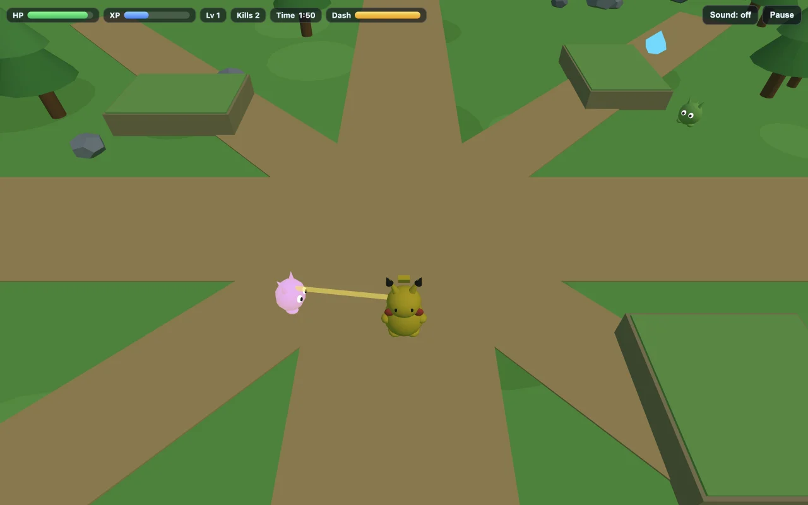

# PokeBonk: Pocket Survivor — OpenGame source

**Active game repository:** [opengameapp/pokebonk](https://github.com/opengameapp/pokebonk). New versions and iteration notes are maintained there; this showcase preserves the original release.

A small 3D survivor game generated and revised through [OpenGame Studio](https://opengame.app/studio). Move through a low-poly meadow, collect XP, choose upgrades and defeat the stone golem before the two-minute run ends.

- **Play and read the tested rules:** [OpenGame PokeBonk](https://opengame.app/games/pokebonk)
- **Guides for the original game:** [PokeBonk.org](https://pokebonk.org/). The OpenGame adaptation has its own rules.
- **Make a revision:** [OpenGame Studio](https://opengame.app/studio)
- **Reproduce the request:** [Initial brief and boss repair](../../prompts/pokebonk.md)

## Run it

Download this repository, then open `showcases/pokebonk/index.html` in a browser with WebGL support. It includes its Three.js runtime and uses no runtime CDN, external models, textures, fonts or audio files. No account, API key, package installation or build is needed to play the downloaded game.

Keyboard: WASD/arrows move, Space jumps, Shift dashes, Esc/P pauses. Phones have movement, Jump and Dash controls. Attacks are automatic. Level-up choices pause the simulation.

## Preserved versions

Both October 17 builds used **MiMo v2.6 Pro**, confirmed from the experiment session's recorded model usage. This names the historical test model, rather than OpenGame's production model configuration.

| Source | Recorded result |
| --- | --- |
| [`index.html`](index.html) | Published October 17 revision. Boss damage/targeting and boss visibility were repaired through Studio. A recorded Pikachu run defeated the boss at 115.6 seconds. |
| [`versions/first-build/index.html`](versions/first-build/index.html) | First generated build, preserved for inspection. **Known defect:** attacks only target ordinary enemies, leaving the separate boss invulnerable. It cannot produce a genuine victory. |

These are the actual downloaded HTML artifacts, preserved byte for byte. The published revision's SHA-256 is `aa49d20767611249bfbb1b0996ba95a41b988de772caf7c52c5f769220039d9f`; the first build's is `d2f6228b537a2b8beef80a333349bbad41e00fd6221142abeae82652a40a0f3d`.

## What was checked

The October 17 real-site checks covered all three starters, keyboard movement/jump/dash, touch movement, XP collection and upgrades, pause, loss, restart and one genuine boss victory. These are bounded observations from this game, rather than a model leaderboard or a claim that every run is balanced. No local source fix is mixed into either preserved generated version.

The source is deliberately small: HTML controls/styles, a bundled Three.js r180 runtime, and the game logic, all in the same file. Search for `Storage + audio` after the runtime bundle to reach the readable game logic.

## Attribution and reuse

This is an independent, unofficial OpenGame fan adaptation, **not the original PokeBonk game's source code**. No original-game code, sprites, official models or music were imported. Procedural fan characters still refer to third-party characters. Original game code is offered under the repository's MIT license; Three.js has its own MIT notice, and third-party character/design/trademark rights are excluded. Read [NOTICE.md](NOTICE.md) before reuse.
